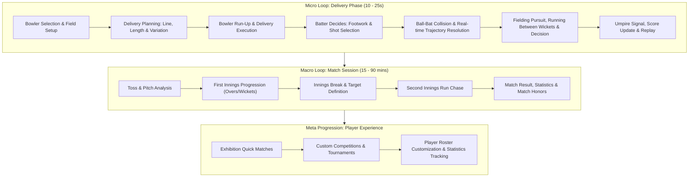

# CRICKET LEGACY — Game Design Document (GDD)
**Version:** 1.0.0-PROPOSAL  
**Target Engine:** Unity 6 (6000.x LTS) with Universal Render Pipeline (URP)  
**Target Platforms:** Android (Primary), iOS (Secondary)  
**Genre:** 3D Sports Simulation / Arcade-Authentic Cricket  
**Inspiration:** EA SPORTS Cricket 07 (Design philosophy, tactical depth, shot satisfaction)  

---

## 1. Executive Summary & Vision

*Cricket Legacy* is a modern, high-fidelity mobile cricket simulation built from first principles. It captures the beloved gameplay philosophy of classic cricket gaming—tactical shot placement, strategic bowling variations, fielding anticipation, and electrifying stadium atmosphere—reimagined specifically for touchscreens and contemporary mobile graphics hardware.

### 1.1 Core Design Pillars
1. **Physics-Driven Gameplay:** Every ball flight, seam movement, bounce, and bat-ball impact is calculated in real time using verified aerodynamic and collision physics, completely eliminating predetermined trajectory rails.
2. **Decoupled Batting Mechanics:** Separate gesture shot intent, directional aiming, and microsecond contact timing, ensuring that outcomes reflect true player skill rather than scripted animations.
3. **Strategic Bowling Mastery:** Full player control over release point, seam angle, swing/spin intensity, and pitch targeting, balanced strictly by bowler attribute constraints.
4. **Intuitive Touch Ergonomics:** A hybrid control scheme optimized for thumbs and fingers in landscape mode, avoiding cramped virtual console pads while delivering granular control.
5. **Original & Legally Unencumbered:** Completely original code, character models, stadium environments, fictional team identities, and broadcast presentation.

---

## 2. Core Gameplay Loops

---

## 3. Batting System Architecture

The batting engine simulates human strokeplay through four independent evaluation stages:
1. **Shot Intent:** The type of stroke chosen by the user's touchscreen gesture.
2. **Directional Aim:** Vector calculated from virtual analog thumb orientation or swipe direction.
3. **Contact Timing:** The microsecond timing window in which the bat blade intersects the ball path.
4. **Execution & Skill Modifiers:** Batter proficiency in the selected shot, composure, and stamina.

### 3.1 Shot Classification Matrix
The game implements 18 fundamental cricket shots across front-foot and back-foot stances:

| Shot Family | Specific Shots | Trigger Mechanism | Target Delivery Length | Risk / Reward Ratio |
| :--- | :--- | :--- | :--- | :--- |
| **Defensive** | Forward Defense, Back-Foot Defense | Tap 'Defend' + neutral/down | Good, Full, Yorker | Very Low / Zero Runs |
| **Drives** | Straight Drive, Cover Drive, Off Drive, On Drive | Swipe Forward-Left / Forward / Forward-Right | Full, Overpitched | Medium / High (Four) |
| **Cross-Bat** | Pull Shot, Hook Shot | Swipe Backward-Left (Upward) | Short, Bouncer | High / High (Six/Wicket) |
| **Cuts** | Square Cut, Late Cut, Upper Cut | Swipe Backward-Right | Short-of-a-length outside off | Medium / Medium-High |
| **Flicks & Glances**| Leg Glance, Pad Flick | Swipe Left along pitch line | Full on pads, Straight | Low-Medium / Low-Medium |
| **Sweeps** | Traditional Sweep, Reverse Sweep, Paddle Sweep | Crouch modifier + Horizontal Swipe | Good/Full against Spinners | Medium-High / High |
| **Lofted / Aggressive**| Lofted Straight, Lofted Cover, Slog Sweep | Hold 'Loft' modifier + Directional Swipe | Any hittable length | Very High / Maximum |

### 3.2 Dynamic Quality Formula
Contact quality $Q \in [0.0, 1.0]$ determines ball exit velocity vector, launch angle, and edge probability:
$$Q = w_T \cdot T_{\text{acc}} + w_D \cdot D_{\text{acc}} + w_S \cdot S_{\text{suit}} + w_P \cdot P_{\text{skill}}$$
- $T_{\text{acc}}$: Timing accuracy ($1.0$ at sweet spot; decays quadratically with early/late offset).
- $D_{\text{acc}}$: Alignment between bat swing trajectory and ball azimuth.
- $S_{\text{suit}}$: Suitability of the shot for the delivery line/length (e.g. hooking a yorker gives $S_{\text{suit}} \approx 0.05$).
- $P_{\text{skill}}$: Batter attribute rating for that specific shot category.
- Normalized default weights: $w_T = 0.40, w_D = 0.25, w_S = 0.20, w_P = 0.15$.

---

## 4. Bowling System Architecture

The bowling system gives the player surgical control over ball dynamics without bypassing attributes.

### 4.1 Bowling Archetypes
1. **Fast Bowlers (135–155 km/h):** High bounce, seam movement, devastating yorkers and bouncers.
2. **Fast-Medium / Swing Specialists (120–135 km/h):** Conventional and reverse swing in air.
3. **Finger Spin / Off-Break (85–100 km/h):** Off-break, arm ball, carrom ball, subtle drift.
4. **Wrist Spin / Leg-Break (75–95 km/h):** Leg-break, googly, flipper, top-spinner with sharp turn.

### 4.2 Three-Stage Bowling Workflow
1. **Delivery Selection:** Bowler selects basic type, variation (e.g. Inswinger, Slower Ball, Googly), and delivery side (Over the wicket / Around the wicket).
2. **Pitch Target Marker:** Bowler positions a circular landing reticle on the 22-yard pitch. Bowler accuracy attribute sets reticle jitter and scatter radius.
3. **Delivery Rhythm Meter:** A dual-ring release gauge tests player timing. Perfect release unlocks maximum pace, tighter scatter, and optimal seam position.

---

## 5. Fielding & Wicketkeeping

Fielding is designed around intelligent autonomous positioning with player tactical override:
- **Assisted Mode (Default):** AI fielders calculate optimal intercept vectors, sprint, dive, pick up, and return to either keeper or bowler end depending on batter runner positions.
- **Manual Mode:** Player can switch active control to the primary chasing fielder, steer with virtual joystick, and tap context buttons (`Dive`, `Direct Hit`, `Keeper Throw`).
- **Throw Targets:** Contextual buttons dynamically prioritize the runner most at risk of being run out.
- **Wicketkeeping:** Keeper stays back for pace bowlers and up to the stumps for spinners, dynamically reacting to edges and missed stumpings.

---

## 6. Match Formats & Rules

The game engine features a fully parameterized match rules engine:
1. **T20 Matches:** 20 overs per side, 6-over mandatory powerplay (max 2 fielders outside 30-yard circle), 5 fielders max on leg side, free hits on no-balls, Super Over resolution for ties.
2. **One Day Internationals (ODI):** 50 overs per side (or configured to 10/20/30 overs in Quick Match), 3 distinct powerplay stages (P1: 1-10, P2: 11-40, P3: 41-50).
3. **Test Matches:** 2 innings per team, unlimited overs per innings, red ball physics (higher seam, persistent swing), follow-on rule (200-run lead), session progressions (Morning, Afternoon, Evening), declarations.
4. **Dynamic Conditions:** Day matches, Evening/Day-Night floodlight matches, pitch wear (dry, green, dusty, deteriorating over days).

---

## 7. User Interface & Broadcast Presentation

- **Layout:** Strictly landscape orientation ($16:9$ to $21:9$ responsive safe-area anchors).
- **Broadcast HUD:** Clean TV-style lower third displaying score, overs, striker/non-striker stats, bowler figure, current over ball-by-ball tokens, and required run rate.
- **Camera Suite:**
  - *Batting Cam:* Behind batter, slightly elevated, tracking ball launch while maintaining field perspective.
  - *Bowling Cam:* Behind bowler during run-up, smoothly transitioning past the umpire at release.
  - *Broadcast Cam:* Dynamic high grandstand camera tracking boundary hits and running.
  - *Action Cam:* Close-up slow-motion replay camera with multi-angle cuts for wickets, boundaries, and near misses.
