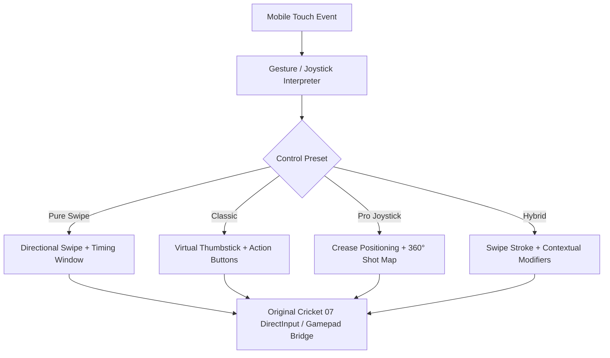

# Phase G: Competitor Mobile Cricket Control Research & Usability Audit

**Project:** Cricket Legacy (Authentic EA SPORTS Cricket 07 on Android)  
**Engineering Discipline:** Mobile Gameplay UX Architecture & Sports Simulation Design  
**Date:** November 10, 2026  
**Git Branch:** `phase-g-mobile-control-system`  

---

## 1. Executive Summary & Objective

To design a best-in-class mobile touch control system for **Cricket Legacy**, we conducted a comprehensive study of the dominant mobile cricket games on the Android platform:
1. **Real Cricket™ / Real Cricket Swipe** (Nautilus Mobile)
2. **World Cricket Championship 3 (WCC3)** (Nextwave Multimedia)
3. **Sachin Saga Cricket Champions** (JetSynthesys)
4. **Stick Cricket / Stick Cricket Premier League** (Stick Sports)
5. **Big Bash Cricket** (PlaySide Studios)

**Core Architectural Principle:**
*We study their usability concepts, touch ergonomics, gesture models, and player mental models. We do not copy proprietary source code, artwork, UI assets, or copyrighted visual assets. Cricket Legacy will deliver an original, ergonomically tailored control system that bridges modern touch mechanics directly into the authentic EA SPORTS Cricket 07 recompiled game engine.*

---

## 2. In-Depth Competitor Analysis

### 2.1 Real Cricket™ & Real Cricket Swipe (Nautilus Mobile)

#### Touch Interaction Model
- **Batting:** Players select shot direction using either an analog stick or direct screen swipe gestures. Real Cricket Swipe popularised a pure gesture-driven approach where the user swipes along the intended line of the stroke.
- **Timing:** Visual cue (ball release indicator / pitch spot circle color transition: green $\to$ yellow $\to$ red) dictates the timing window.
- **Shot Map System:** The "Shot Map" UI allows players to configure shot types across a 360-degree compass (e.g. cover drive, straight punch, pull, cut, sweep, leg glance).
- **Pro Joystick Mode:** Decouples batsman crease positioning (left analog stick) from stroke execution (right analog wheel or swipe).
- **Ground vs. Loft:** Dedicated toggle button on the screen toggles between grounded placement and aerial lofted shots.
- **Running:** Dedicated on-screen `RUN` button with a circular meter showing batsman progress between creases, and a prominent `CANCEL` button.
- **Bowling:** Three-stage interaction:
  1. Drag cursor on pitch to set landing mark.
  2. Tap/drag meter to set bowling speed and swing/seam deviation.
  3. Release ball at peak of delivery stride gauge.

#### Usability Evaluation for Cricket Legacy
- **Strengths:** Intuitive swipe direction mapping; distinct separation of loft and ground execution; clean running cancellation.
- **Suitability for Cricket Legacy:** The 360-degree directional swipe gesture directly aligns with Cricket 07's analog stroke selection. Providing both Classic Joystick and Pro Joystick modes matches player expectations.

---

### 2.2 World Cricket Championship 3 (WCC3) (Nextwave Multimedia)

#### Touch Interaction Model
- **Batsman Movement:** Left virtual joystick allows the batsman to shuffle across the crease (e.g. outside off stump or walking across to leg).
- **Advance Action:** An on-screen "ADVANCE" button triggers the batsman stepping down the pitch to turn good-length deliveries into half-volleys.
- **Swipe Batting:** Player swipes in the desired stroke direction; stroke power is modulated by a combination of swipe speed and an optional "Power Meter".
- **Bowling Interface:** 
  1. Pitch indicator dragged to select line and length.
  2. Delivery variation button selected (Outswinger, Inswinger, Leg Cutter, Off Cutter, Yorker, Bouncer).
  3. Oscillating delivery needle stopped in the green zone to maximize accuracy and minimize no-balls/wides.
- **Fielding Interaction:** Dynamic fielding ring: when the ball is struck into the outfield, the player taps an on-screen target ring to execute a clean pickup, then selects the stumps target (Keeper end vs. Bowler end).

#### Usability Evaluation for Cricket Legacy
- **Strengths:** Excellent bowler delivery type categorization; intuitive advance button; clear fielding targets.
- **Suitability for Cricket Legacy:** Cricket 07 already contains authentic bowler types (`S` Standard, `A` Swing, `D` Cut, `W` Bouncer). Replicating WCC3's clear delivery selection icons mapped to these engine states provides immediate clarity for mobile players.

---

### 2.3 Sachin Saga Cricket Champions (JetSynthesys)

#### Touch Interaction Model
- **Gesture Batting:** Pure swipe batting where swipe velocity and vector angle calculate stroke type.
- **Power Shot Button:** A glowing contextual "Power Shot" button activates maximum loft when charged.
- **Timing Gauge:** Pitch delivery indicator flashes with an expanding ring; swiping precisely when the ring hits the inner circle yields "Perfect" timing.
- **Running:** Tap once to run; double-tap to sprint for the second run; emergency hold to cancel.

#### Usability Evaluation for Cricket Legacy
- **Strengths:** High responsiveness and low visual clutter on small displays.
- **Suitability for Cricket Legacy:** Minimalist HUD option that keeps the camera and stadium unobstructed.

---

### 2.4 Stick Cricket & Other Mobile Titles

#### Touch Interaction Model
- **Two-Touch / Two-Zone Batting:** Screen split into Left (Off-side shots) and Right (Leg-side shots). Simple and forgiving, but lacks 360-degree depth.
- **Arcade Bowling:** Dragging a bowling ball along a 3D trajectory path.

#### Usability Evaluation for Cricket Legacy
- Too simplistic for an authentic simulation like Cricket 07, but reinforces the requirement for low input latency ($\le 25\text{ ms}$).

---

## 3. Comparative Usability Matrix

| Feature / Dimension | Real Cricket | WCC3 | Sachin Saga | Proposed Cricket Legacy Architecture |
| :--- | :--- | :--- | :--- | :--- |
| **Primary Batting** | Swipe / Dual Joystick | Joystick + Swipe | Pure Swipe | **4 Modes:** Pure Swipe, Classic, Pro, Hybrid |
| **Direction Selection** | 360° Touch Swipe | Virtual Joystick + Swipe | Screen Swipe Vector | **8-Sector & 360° Vector Mapping** |
| **Shot Power / Loft** | Toggle Loft Button | Power Slider / Loft | Power Button | **Contextual Loft Toggle + Swipe Velocity** |
| **Timing Feedback** | Visual Pitch Marker | Oscillating Needle | Contracting Timing Ring| **Authentic Engine Timing + Visual Feedback** |
| **Batsman Movement** | Left Analog Stick | Left Analog Stick | Fixed Stance | **Left Virtual Joystick (Crease Shuffle)** |
| **Bowling Aiming** | Pitch Marker Drag | Pitch Marker Drag | Line/Length Sliders | **Interactive Pitch Marker + Drag Reticle** |
| **Delivery Selection**| HUD Wheel | Grid Buttons | Grid Buttons | **4-Quadrant Delivery HUD (`S`, `A`, `D`, `W`)** |
| **Running Controls** | Tap Run / Cancel | Tap Run / Cancel | Tap Run / Hold Cancel | **Dual Button (`RUN` / `CANCEL`) + Crease HUD** |
| **Fielding Mode** | Semi-Assisted | Quick-Time Target | Automated | **Assisted (Default) & Manual Joystick** |
| **Customization** | Fixed Presets | Movable HUD | Fixed HUD | **Fully Customizable (Pos, Size, Alpha, Left-Hand)** |

---

## 4. Synthesis of Control Principles for Cricket Legacy

From this audit, six essential design principles emerge for Cricket Legacy:

1. **Decouple Touch Tracking from Engine Input:** Touch screen events must flow through a high-frequency gesture interpreter that outputs standard gamepad/keyboard signals without altering engine math.
2. **Support Multiple Player Archetypes:** 
   - Casual players prefer **Pure Swipe** (one-finger / two-finger gestures).
   - Hardcore players prefer **Classic Joystick + Buttons** or **Pro Joystick + Shot Map**.
3. **Fail-Safe Multitouch State Machine:** A finger assigned to the joystick must never accidentally trigger a shot or cancel a run when moving across screen quadrants.
4. **Context-Sensitive HUD:** Only show bowling controls when bowling; only show batting controls when batting; display running buttons only when the ball is live.
5. **Zero-Latency Ingress:** Touch events processed on the UI thread must be pushed via thread-safe atomic lockless ring buffers to the native engine to guarantee sub-frame ($\le 16\text{ ms}$) response.
6. **Preserve Original Physics Integrity:** The original game engine must remain 100% in control of ball bounce, seam deviation, batsman timing windows, and ball-bat collision dynamics.

---

## 5. Deliverable Approval

Certified by: Senior Gameplay Input Architect & Mobile UX Designer  
Artifact Created: `PHASE_G_COMPETITOR_CONTROL_RESEARCH.md`
