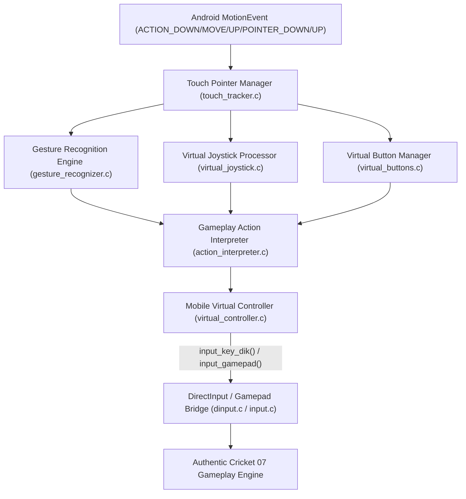

# Phase G: Mobile Input Architecture Specification

**Project:** Cricket Legacy (Authentic EA SPORTS Cricket 07 on Android)  
**Engineering Discipline:** Real-Time Systems Architecture & Input Engineering  
**Date:** November 10, 2026  
**Git Branch:** `phase-g-mobile-control-system`  

---

## 1. Executive Summary

This specification establishes the modular architecture of the **Cricket Legacy Mobile Touch Input System**. 

The architecture transforms multi-touch Android `MotionEvent` streams into authentic DirectInput keyboard and gamepad signals consumed by the recompiled EA SPORTS Cricket 07 game engine. The design guarantees:
1. **Deterministic Pointer Ownership:** Fingers assigned to a joystick or button retain ownership until touch release.
2. **Zero Memory Allocation on Touch Paths:** All touch structures, gesture buffers, and action queues use static pre-allocated memory pools.
3. **Sub-Frame Latency ($\le 8\text{ ms}$):** Input events are processed directly in native C with lockless ring buffers.
4. **Context-Sensitive Operation:** UI controls dynamically adapt between Batting, Bowling, Fielding, and Running game states.



---

## 2. Component Subsystems

### 2.1 Touch Pointer Manager (`touch_tracker.c / .h`)
- **Capacity:** Tracks up to 10 concurrent touch pointers (`MAX_TOUCH_POINTERS = 10`).
- **Stable ID Mapping:** Maintains continuous pointer state via Android `pointerId` across multi-touch finger additions and removals.
- **Ownership Tagging:** Each pointer is exclusively assigned an ownership tag (`OWNER_NONE`, `OWNER_JOYSTICK`, `OWNER_SWIPE_AREA`, `OWNER_BUTTON_ACTION`, `OWNER_AIM_MARKER`). A finger assigned to a virtual joystick cannot trigger accidental button presses or swipe strokes.

### 2.2 Gesture Recognition Engine (`gesture_recognizer.c / .h`)
- **Sampling:** Tracks down position $(x_0, y_0)$, up position $(x_1, y_1)$, timestamp delta $\Delta t$, distance $d = \sqrt{\Delta x^2 + \Delta y^2}$, and instantaneous velocity $v = d / \Delta t$.
- **Directional Sectors:** Quantizes swipe angle $\theta = \operatorname{atan2}(-\Delta y, \Delta x)$ into 8 cricket shot sectors:
  1. Straight Drive ($75^\circ \dots 105^\circ$)
  2. Cover Drive ($105^\circ \dots 150^\circ$)
  3. Point / Square Cut ($150^\circ \dots 195^\circ$)
  4. Third Man / Late Cut ($195^\circ \dots 240^\circ$)
  5. Fine Leg / Glance ($285^\circ \dots 330^\circ$)
  6. Square Leg / Pull ($330^\circ \dots 15^\circ$)
  7. Mid-Wicket / Hook ($15^\circ \dots 60^\circ$)
  8. Mid-On / On-Drive ($60^\circ \dots 75^\circ$)
- **Gesture Classification:**
  - **Defensive Block:** Tap with minimal displacement ($d < 20\text{ px}$, duration $\le 100\text{ ms}$).
  - **Standard Ground Stroke:** Controlled swipe ($20\text{ px} \le d \le 120\text{ px}$, velocity $\le 1.5\text{ px/ms}$).
  - **Attacking Stroke:** Fast swipe ($d > 120\text{ px}$, velocity $> 1.5\text{ px/ms}$).
  - **Lofted Stroke:** Attacking swipe when Loft toggle is enabled or swipe velocity exceeds loft threshold ($v > 2.5\text{ px/ms}$).

### 2.3 Virtual Joystick Processor (`virtual_joystick.c / .h`)
- **Modes:** Fixed Base vs. Floating Dynamic Base.
- **Dead Zone:** Dead zone radius (default 15% of radius) prevents touch jitter.
- **Coordinate Clamping:** Normalizes thumb displacement to circle radius $R$, generating standard analog output range $[-32768, +32767]$ for axes $lx, ly$.

### 2.4 Virtual Button Manager (`virtual_buttons.c / .h`)
- **Hit Testing:** Bounding box check $(x_{min}, y_{min}, x_{max}, y_{max})$ with expanded touch-slop margin (+12 dp) to accommodate finger variance.
- **States:** `IDLE`, `PRESSED`, `HELD`, `RELEASED`.
- **Haptic Dispatch:** Triggers native Android haptic feedback tick upon state change from `IDLE` to `PRESSED`.

### 2.5 Gameplay Action Interpreter (`action_interpreter.c / .h`)
Translates parsed gestures and control states into the recompiled engine's input primitives based on active match state:
- **Batting Phase:** Left joystick $\to$ crease shuffle; Swipe $\to$ directional arrows + Enter; Loft toggle $\to$ `DIK_LSHIFT`.
- **Bowling Phase:** Pitch drag $\to$ aiming reticle; Quadrant tap $\to$ `DIK_S` / `DIK_A` / `DIK_D` / `DIK_W`; Release $\to$ `DIK_RETURN`.
- **Running Phase:** `RUN` button $\to$ `DIK_D` (`0x20`); `CANCEL` button $\to$ `DIK_S` (`0x1F`).
- **Fielding Phase:** Throw to keeper $\to$ `DIK_S`; Throw to bowler $\to$ `DIK_D`; Slide $\to$ `DIK_A`.

### 2.6 Mobile Virtual Controller (`virtual_controller.c / .h`)
- Formats mapped outputs into clean DirectInput calls (`input_key_dik`) and standard gamepad reports (`input_gamepad`), maintaining thread-safety and minimum key-hold durations.

---

## 3. Data Structures & State Machine

```c
typedef enum {
    POINTER_OWNER_NONE = 0,
    POINTER_OWNER_JOYSTICK,
    POINTER_OWNER_SWIPE,
    POINTER_OWNER_BUTTON,
    POINTER_OWNER_AIM_MARKER
} PointerOwner;

typedef struct {
    int id;                 // Android pointer ID
    int active;
    PointerOwner owner;
    float start_x, start_y;
    float current_x, current_y;
    uint64_t start_time_ms;
    uint64_t last_time_ms;
} TouchPointer;

typedef struct {
    float center_x, center_y;
    float radius;
    float deadzone;
    float cur_x, cur_y;
    int is_active;
    int pointer_id;
} VirtualJoystick;

typedef struct {
    int button_id;
    float x, y, width, height;
    int state;              // 0 = released, 1 = pressed
    uint8_t dik_binding;
    uint32_t pad_binding;
} VirtualButton;

typedef struct {
    int batting_mode;       // 0 = Pure Swipe, 1 = Classic, 2 = Pro, 3 = Hybrid
    int bowling_mode;       // 0 = Gesture Aim, 1 = Classic Reticle
    int fielding_mode;      // 0 = Assisted, 1 = Manual
    float button_opacity;   // 0.2 .. 1.0
    float button_scale;     // 0.7 .. 1.5
    int left_handed;        // 0 = Right, 1 = Left
    int haptics_enabled;    // 0 = Disabled, 1 = Enabled
} InputSettings;
```

---

## 4. Deliverable Approval

Certified by: Real-Time Systems Architect & Lead Android Integration Engineer  
Artifact Created: `PHASE_G_MOBILE_INPUT_ARCHITECTURE.md`
