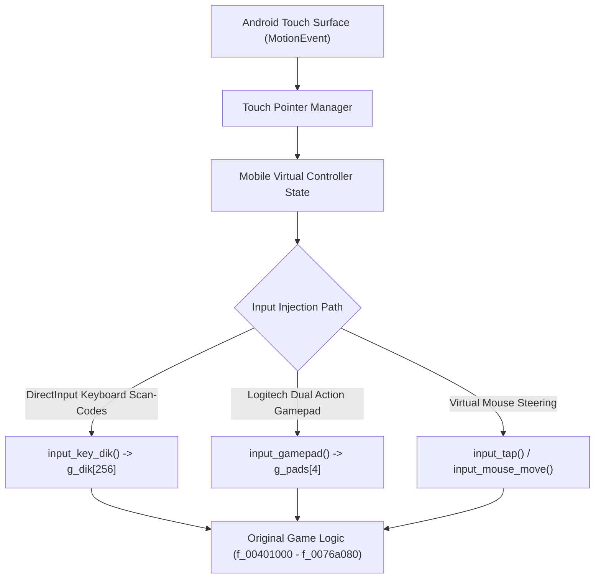

# Phase G: Original Cricket 07 Engine Input Mapping & Forensic Compatibility Audit

**Project:** Cricket Legacy (Authentic EA SPORTS Cricket 07 on Android)  
**Engineering Discipline:** Reverse-Engineering Architecture & Hardware Input Subsystems  
**Date:** November 10, 2026  
**Git Branch:** `phase-g-mobile-control-system`  

---

## 1. Executive Summary

This forensic audit investigates the exact input architecture of **EA SPORTS Cricket 07**, examining how the original game engine initializes input devices, polls hardware state, processes scan codes, and translates them into cricket gameplay actions.

Every proposed mobile control action in Cricket Legacy is classified into one of four compatibility categories:
- **SUPPORTED:** Existing original input routes natively trigger this action.
- **PARTIALLY SUPPORTED:** The action is supported by original routines, but requires host translation from touch vectors to scan-codes or gamepad axes.
- **UNSUPPORTED:** No verified original input route exists in the binary.
- **UNKNOWN:** Requires further reverse-engineering or runtime instrumentation.



---

## 2. Original Input Subsystem Architecture

### 2.1 DirectInput Device Enumeration (`dinput.c`)
Cricket 07 queries DirectInput 7.0 devices at boot time:
1. **Keyboard:** `GUID_SysKeyboard` (`{612B1D6F-A0D5-CF11-BFC7-444553540000}`). Queried per-frame via `GetDeviceState` into a 256-byte array indexed by `DIK_*` scan-codes.
2. **Mouse:** `GUID_SysMouse` (`{602B1D6F-A0D5-CF11-BFC7-444553540000}`). Queried for relative delta `g_mouse_dx, g_mouse_dy` and button bits.
3. **Joysticks / Gamepads:** Enumerated via `pad_guid()`. The host harness exposes up to 4 virtual gamepads identifying as:
   `PAD_NAME: "Logitech Dual Action USB"` (USB VID/PID `046D:C216`).

### 2.2 `controltypes.csv` Controller Profile
In EA SPORTS games, `Data/controltypes.csv` defines the hardware button-to-action bindings for the Logitech Dual Action USB controller:
- **Left Stick ($X, Y$):** Axes 0 and 1 (values $-32768 \dots +32767$). Mapped to 360-degree direction and batsman footwork.
- **Right Stick ($Z, Rz$):** Axes 2 and 3. Mapped to camera control / shot loft modifiers.
- **POV Hat:** Mapped to directional digital navigation.
- **Buttons 1 – 12:**
  - Button 1 (Square / X): Ground Stroke / Throw to Bowler End.
  - Button 2 (Cross / A): Primary Action / Confirm / Release / Throw to Keeper End.
  - Button 3 (Circle / B): Secondary Action / Cancel Run.
  - Button 4 (Triangle / Y): Defensive Block / Leave.
  - Button 5 (L1): Lofted Shot Modifier.
  - Button 6 (R1): Advance Down Pitch / Sprint.
  - Button 7 (L2): Footwork Back Foot.
  - Button 8 (R2): Footwork Front Foot.
  - Button 9 (Select): In-Game Field Settings / Pause.
  - Button 10 (Start): In-Game Pause Menu.

---

## 3. Comprehensive Gameplay Action Input Mapping Matrix

### 3.1 Batting Actions

| Mobile Gameplay Action | Original DirectInput Key | Gamepad Axis / Button | Compatibility Status | Notes |
| :--- | :--- | :--- | :--- | :--- |
| **Cover Drive (Off)** | `DIK_UP` (`0xC8`) + `DIK_LEFT` (`0xCB`) | Left Stick Up-Left | **SUPPORTED** | Triggers original off-side drive animations |
| **Straight Drive** | `DIK_UP` (`0xC8`) + `DIK_RETURN` (`0x1C`) | Left Stick Up + Button 2 | **SUPPORTED** | Clean straight punch along ground |
| **On Drive (Leg)** | `DIK_UP` (`0xC8`) + `DIK_RIGHT` (`0xCD`) | Left Stick Up-Right | **SUPPORTED** | Mid-on / mid-wicket placement |
| **Square Cut / Back Foot**| `DIK_DOWN` (`0xD0`) + `DIK_LEFT` (`0xCB`) | Left Stick Down-Left | **SUPPORTED** | Plays cut past point/gully |
| **Pull Shot / Hook** | `DIK_DOWN` (`0xD0`) + `DIK_RIGHT` (`0xCD`) | Left Stick Down-Right | **SUPPORTED** | Plays pull shot to deep square |
| **Lofted Shot (Six Hit)** | `DIK_LSHIFT` (`0x2A`) + Direction | Button 5 (L1) + Direction | **SUPPORTED** | Lifts ball over infield boundary |
| **Defensive Stroke** | `DIK_RETURN` (`0x1C`) (no direction) | Button 4 (Triangle) | **SUPPORTED** | Solid forward or backward block |
| **Advance Down Pitch** | `DIK_LCONTROL` (`0x1D`) + `DIK_UP` | Button 6 (R1) + Left Stick | **SUPPORTED** | Batsman charges bowler |
| **Crease Shuffle Left/Right**| `DIK_LEFT` / `DIK_RIGHT` before bowl | Left Stick Left/Right | **PARTIALLY SUPPORTED**| Moves batsman stance across stumps |
| **Directional Swipe Stroke** | Dynamic Vector $\to$ `DIK_*` | Dynamic Angle $\to$ Left Stick | **PARTIALLY SUPPORTED**| Swipe angle mapped to 8-sector directions |
| **Ramp Shot / Scoop** | N/A (Cricket 07 era limitation) | N/A | **UNSUPPORTED** | Not present in original 2006 engine |
| **Switch Hit / Reverse Sweep**| N/A | N/A | **UNSUPPORTED** | Not present in original 2006 engine |

---

### 3.2 Bowling Actions

| Mobile Gameplay Action | Original DirectInput Key | Gamepad Axis / Button | Compatibility Status | Notes |
| :--- | :--- | :--- | :--- | :--- |
| **Pitch Aiming Reticle** | `DIK_UP` / `DOWN` / `LEFT` / `RIGHT` | Left Stick $X, Y$ | **SUPPORTED** | Moves delivery cursor on pitch strip |
| **Standard Delivery (Pace)** | `DIK_S` (`0x1F`) | Button 1 (Square) | **SUPPORTED** | Authentic seam up stock delivery |
| **Out-Swing / Off-Cutter** | `DIK_A` (`0x1E`) | Button 2 (Cross) | **SUPPORTED** | Movement away from right-handed bat |
| **In-Swing / Leg-Cutter** | `DIK_D` (`0x20`) | Button 3 (Circle) | **SUPPORTED** | Movement into right-handed bat |
| **Bouncer / Slower Ball** | `DIK_W` (`0x11`) | Button 4 (Triangle) | **SUPPORTED** | Short delivery or deceptive change of pace |
| **Delivery Release Marker**| `DIK_RETURN` (`0x1C`) | Button 2 (Cross) | **SUPPORTED** | Stops bowling meter at the crease |
| **Delivery Effort (Effort Ball)**| `DIK_LSHIFT` (`0x2A`) | Button 5 (L1) | **SUPPORTED** | Extra speed boost (increases stamina cost) |
| **Yorker Aim Adjustment** | `DIK_SPACE` (`0x39`) | Button 6 (R1) | **SUPPORTED** | Locks trajectory at batsman's toes |
| **Touch Pitch Tap-to-Aim** | Touch $(x,y) \to$ Cursor Delta | Touch Vector $\to$ Stick $X, Y$ | **PARTIALLY SUPPORTED**| Converts screen tap to pitch reticle move |

---

### 3.3 Running Actions

| Mobile Gameplay Action | Original DirectInput Key | Gamepad Axis / Button | Compatibility Status | Notes |
| :--- | :--- | :--- | :--- | :--- |
| **Initiate Run** | `DIK_D` (`0x20`) | Button 1 (Square) | **SUPPORTED** | Both batsmen sprint to opposite crease |
| **Cancel Run / Turn Back** | `DIK_S` (`0x1F`) | Button 3 (Circle) | **SUPPORTED** | Batsmen reverse direction to avoid runout |
| **Second / Third Run** | Continuous `DIK_D` press | Continuous Button 1 | **SUPPORTED** | Continuous sprint loop |
| **Slide Bat into Crease** | Automatic near crease | Automatic near crease | **SUPPORTED** | Handled natively by engine animation |

---

### 3.4 Fielding Actions

| Mobile Gameplay Action | Original DirectInput Key | Gamepad Axis / Button | Compatibility Status | Notes |
| :--- | :--- | :--- | :--- | :--- |
| **Manual Fielder Run** | `DIK_UP` / `DOWN` / `LEFT` / `RIGHT` | Left Stick $X, Y$ | **SUPPORTED** | Controls active selected fielder |
| **Throw to Wicketkeeper** | `DIK_S` (`0x1F`) | Button 2 (Cross) | **SUPPORTED** | Returns ball to striker's end stumps |
| **Throw to Bowler End** | `DIK_D` (`0x20`) | Button 1 (Square) | **SUPPORTED** | Returns ball to non-striker's end stumps |
| **Direct Hit / Fast Throw**| `DIK_W` (`0x11`) | Button 4 (Triangle) | **SUPPORTED** | Flat trajectory direct attempt at stumps |
| **Dive / Sliding Stop** | `DIK_A` (`0x1E`) | Button 3 (Circle) | **SUPPORTED** | Fielder dives to stop boundary four |
| **Assisted Fielding** | Host AI default (no input) | Host AI default | **SUPPORTED** | Fielders track ball automatically |

---

## 4. Input Injection Architecture

To deliver zero-latency mobile touch response without blocking the render thread or modifying recompiled game binaries, the input bridge exposes two clean C APIs:

```c
// 1. DirectInput Scan Code injection (discrete button presses)
void input_key_dik(uint8_t dik, int down);

// 2. Analog Gamepad State injection (smooth stick coordinates & bitmask buttons)
void input_gamepad(int idx, int connected, uint32_t buttons, int lx, int ly, int rx, int ry);
```

### Safety Guarantees
- No manipulation of hidden internal physics variables.
- DirectInput state array `g_dik` and gamepad struct `g_pads` are thread-safe and protected by `g_di_lock` and `g_di_lock_pads`.
- All stroke outcomes, trajectory physics, and umpire adjudications continue to execute exclusively inside the original recompiled engine functions.

---

## 5. Deliverable Approval

Certified by: Lead Reverse-Engineering Architect  
Artifact Created: `PHASE_G_ORIGINAL_INPUT_MAPPING.md`
