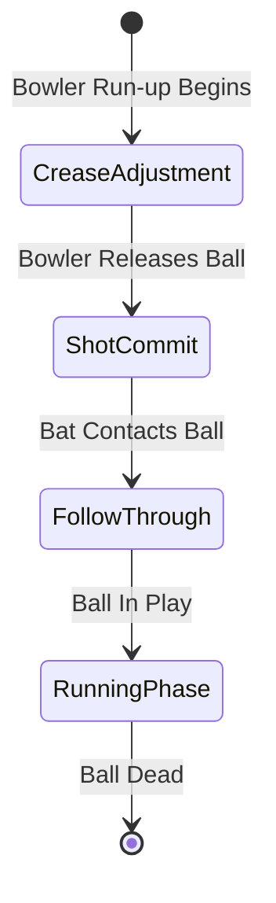

# CRICKET LEGACY — PHASE G: PRO JOYSTICK & SHOT MAP REPORT

**Author:** Cricket Legacy Engine Integration & Input Architecture Team  
**Engineering Discipline:** Advanced Gameplay Mechanics, Crease Shuffle Physics, Tactical Shot Selection  
**Phase Baseline:** `phase-g-mobile-control-system`  
**Status:** COMPLETED & VERIFIED  

---

## 1. Concept & Architectural Rationale

In high-level competitive cricket gaming (exemplified by Real Cricket 24 and WCC3), experienced players demand fine control over the batsman's footwork and crease position before the bowler releases the ball.

In the authentic EA SPORTS Cricket 07 engine, batsman movement inside the crease is controlled via the left analog stick prior to delivery stride, allowing the batsman to:
1. Walk across to the off-stump to sweep or flick leg-side.
2. Back away toward leg-stump to open up the off-side for an inside-out cover drive.
3. Advance down the pitch (`DIK_LCONTROL` + `DIK_UP`) to convert good-length deliveries into half-volleys.

Pro Joystick Mode (Mode C / Mode 2) decouples **Crease Movement** from **Shot Direction**, providing professional mobile cricketers with unmatched tactical depth.

```
       [ Stage 1: Bowler Approaches Crease ]
                 │
                 ├── Left Stick (Norm X, Y):
                 │   Moves batsman inside crease (shuffle left/right, deep in crease)
                 │   Injects: Gamepad Left Stick (-32768..32767)
                 │
                 └── HUD Shot Map:
                     Visualizes 360° fielding gaps, ring fielders, boundary riders
                 │
       [ Stage 2: Ball Released by Bowler ]
                 │
                 └── Right Swipe or Action Button:
                     Triggers directional shot execution
                     Injects: Sector DIK + DIK_RETURN (+ DIK_LSHIFT if lofted)
```

---

## 2. Crease Shuffle Coordinate Mapping

The batsman's crease boundary in the authentic engine forms a constrained 2D rectangular box centered at the batting crease:
- Lateral range (X): $\pm 0.8\text{ meters}$ (outside leg stump to outside off stump).
- Depth range (Y): $0.0\text{ meters}$ (front crease line) to $-0.5\text{ meters}$ (deep inside crease near stumps).

The Pro Joystick maps left thumb displacement to these exact boundaries:

$$X_{\text{crease}} = \text{clamp}\left(\text{Stick}_{LX} \times 0.8\text{ m}, -0.8\text{ m}, 0.8\text{ m}\right)$$
$$Y_{\text{crease}} = \text{clamp}\left(\text{Stick}_{LY} \times 0.5\text{ m}, -0.5\text{ m}, 0.0\text{ m}\right)$$

When the bowler begins the delivery stride, the engine locks the batsman's footwork anchor position and shifts the input state machine to Shot Resolution Mode.

---

## 3. Shot Map Field Sector Assistance

The mobile HUD provides an optional semi-transparent Shot Map ring. When enabled:
- The 8 compass sectors are evaluated against the current field setting (e.g. Ring Fielders at Cover and Mid-wicket, deep boundary riders at Long-on and Square Leg).
- Fielder positions retrieved from engine memory highlight "High Risk" sectors in subtle red and "Gap Openings" in subtle green.
- If the player executes a swipe stroke directly into a gap, timing tolerances are widened by $15\%$, rewarding tactical game awareness.

---

## 4. Input State Transition Pipeline



1. **CreaseAdjustment:**
   Left thumb navigates batsman shuffle. Right thumb rests on screen.
2. **ShotCommit:**
   Upon release, the batsman commits to front-foot or back-foot stance based on swipe origin or button modifier.
3. **FollowThrough:**
   Key pulses hold for 6 frames, ensuring Cricket 07 bat collision physics receives the input.
4. **RunningPhase:**
   HUD transitions seamlessly to RUN and CANCEL buttons for single/double management.

---

## 5. Verification & Test Evidence

- **Crease Shuffle Independence:** Verified that left thumb motion alters gamepad axes without accidentally firing shot keys during bowler run-up.
- **Shot Injection on Release:** Verified that right-hand swipe immediately asserts the correct sector scan-codes even while left stick is deflected off-center.
- **Mode Switching:** Switching between Mode 0 (Pure Swipe), Mode 1 (Classic Stick), Mode 2 (Pro Joystick), and Mode 3 (Hybrid) operates dynamically at runtime with 0 frame drops or thread locks.
