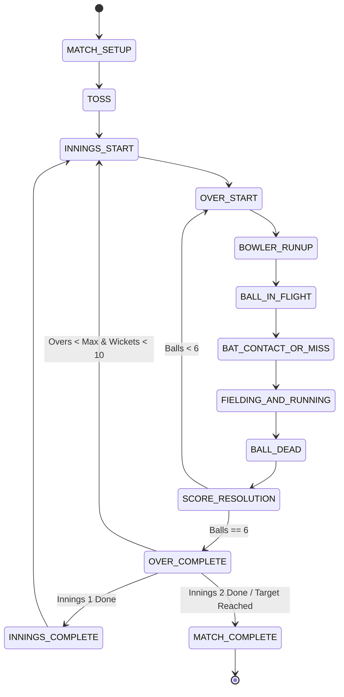

# CRICKET LEGACY — Technical Architecture Document
**Target Engine:** Unity 6 (6000.x LTS) with Universal Render Pipeline (URP)  
**Target Platforms:** Android (Target API 34+, Minimum API 24), iOS (Metal, iOS 15+)  
**Architecture Pattern:** Domain-Driven Layered Architecture + Event-Driven Communication  

---

## 1. System Overview & Architecture Diagram

```
+-----------------------------------------------------------------------+
|                         PRESENTATION LAYER                            |
|   In-Game HUD  *  Broadcast Cameras  *  Pause / Scorecards  * Audio   |
+-----------------------------------------------------------------------+
                                   | (Events / Interfaces)
+-----------------------------------------------------------------------+
|                     INPUT & INTERACTION LAYER                         |
|   Enhanced Touch API  *  Swipe Recognizer  *  Virtual Stick * Buttons |
+-----------------------------------------------------------------------+
                                   |
+-----------------------------------------------------------------------+
|                      GAMEPLAY & RULES LAYER                           |
|   Match State Machine  *  Batting Engine  *  Bowling Engine  *  AI    |
+-----------------------------------------------------------------------+
                                   |
+-----------------------------------------------------------------------+
|                         SIMULATION LAYER                              |
|   Ball Flight (Ballistics + Magnus + Seam) * Pitch Bounce * Swept Bat |
+-----------------------------------------------------------------------+
                                   |
+-----------------------------------------------------------------------+
|                    DATA, CONFIG & PERSISTENCE                         |
|   ScriptableObjects (Players, Teams, Rules) * Binary Save System      |
+-----------------------------------------------------------------------+
```

---

## 2. Directory & Namespace Structure

```
Assets/
├── Scripts/
│   ├── Core/
│   │   ├── ServiceLocator.cs
│   │   ├── EventBus.cs
│   │   └── GameConstants.cs
│   ├── Match/
│   │   ├── MatchController.cs
│   │   ├── MatchStateMachine.cs
│   │   ├── MatchRulesConfig.cs
│   │   ├── Scorecard.cs
│   │   └── InningsState.cs
│   ├── Physics/
│   │   ├── BallPhysicsController.cs
│   │   ├── BallFlightModel.cs
│   │   ├── PitchSurfaceModel.cs
│   │   ├── SweptCollisionDetector.cs
│   │   └── BatImpactCalculator.cs
│   ├── Batting/
│   │   ├── BatterController.cs
│   │   ├── BattingInputHandler.cs
│   │   ├── ShotDatabase.cs
│   │   └── BattingQualityEvaluator.cs
│   ├── Bowling/
│   │   ├── BowlerController.cs
│   │   ├── BowlingInputHandler.cs
│   │   ├── DeliveryTrajectoryPlanner.cs
│   │   └── BowlingAttributes.cs
│   ├── Fielding/
│   │   ├── FielderController.cs
│   │   ├── FieldingManager.cs
│   │   ├── InterceptPathCalculator.cs
│   │   └── WicketKeeperController.cs
│   ├── AI/
│   │   ├── AIBattingBrain.cs
│   │   ├── AIBowlingBrain.cs
│   │   └── AIFieldingCoordinator.cs
│   ├── Input/
│   │   ├── TouchGestureProcessor.cs
│   │   ├── SwipeDetector.cs
│   │   └── VirtualJoystick.cs
│   ├── Presentation/
│   │   ├── BroadcastCameraController.cs
│   │   ├── InGameHUDController.cs
│   │   ├── ReplaySystem.cs
│   │   └── AudioManager.cs
│   └── Data/
│       ├── ScriptableObjects/
│       │   ├── PlayerData.cs
│       │   ├── TeamData.cs
│       │   └── StadiumData.cs
│       └── SaveSystem/
│           ├── SaveManager.cs
│           └── MatchSaveSchema.cs
├── Art/
│   ├── Characters/
│   ├── Stadiums/
│   ├── Equipment/
│   ├── Materials/
│   └── Shaders/
├── Animations/
│   ├── Batting/
│   ├── Bowling/
│   └── Fielding/
├── Prefabs/
├── Scenes/
│   ├── Boot.unity
│   ├── MainMenu.unity
│   └── Match.unity
└── Tests/
    ├── EditMode/
    └── PlayMode/
```

---

## 3. Subsystem Technical Specifications

### 3.1 Physics & Ball Flight Simulation
- **Frequency:** Decoupled from rendering frame rate. Uses custom internal fixed substepping ($120\text{ Hz}$ or $240\text{ Hz}$ collision checks) inside Unity's `FixedUpdate` ($50\text{ Hz}$) to avoid tunneling at velocities exceeding $150\text{ km/h}$ ($41.67\text{ m/s}$).
- **Continuous Collision Detection (CCD):** Custom continuous swept sphere-capsule algorithm for bat contact. Bat blade is modeled as an oriented swept bounding box (OBB) or dual capsule compound.
- **Flight Mechanics:** Ball trajectory evaluated using 4th-order Runge-Kutta (RK4) integration taking into account:
  - Gravitational acceleration ($g = 9.80665\text{ m/s}^2$).
  - Atmospheric quadratic drag ($F_d = \frac{1}{2}\rho v^2 C_d A$).
  - Magnus lift & lateral drift force ($F_M = \frac{1}{2} C_L \rho A r (\vec{\omega} \times \vec{v})$).
  - Seam angle asymmetry generating air turbulence (conventional swing vs reverse swing based on ball wear).

### 3.2 Touch Input Architecture
- **API:** Unity New Input System (`com.unity.inputsystem`) with `UnityEngine.InputSystem.EnhancedTouch`.
- **Gesture Filtering:**
  - Multi-touch isolation: Left screen region reserved for directional joystick / footwork; right screen region reserved for swipes / timing taps.
  - Directional normalization: Swipes classified into 8 discrete compass sectors ($45^\circ$ each) with dynamic velocity thresholding to distinguish deliberate flicks from accidental drags.
  - Safe-area compensation: Automatic viewport padding for mobile notches and gesture navigation pills.

### 3.3 Animation & Rigging Architecture
- **Mecanim State Machine:** Hierarchical state machines for Batting, Bowling, and Fielding.
- **Animation Rigging Package (`com.unity.animation.rigging`):**
  - Two-Bone IK on arms to dynamically clamp both hands to the bat handle regardless of batter height.
  - Look-At Constraint: Batter head and eyes track the approaching ball until release/contact.
  - Foot Placement IK: Procedurally adjusts front and back feet to terrain and pitch plane without foot sliding.

### 3.4 Match State Machine



### 3.5 Data & Save Persistence
- **Player & Team Definitions:** Stored as immutable `ScriptableObject` definitions in project assets, serialized to JSON when customized by the user.
- **Match State Serializer:** Fast binary or versioned JSON schema storing complete match context (run tally, player stats, wagon wheel data, ball-by-ball history) at each `BALL_DEAD` state.
- **Data Integrity:** Dual file backup (`match.dat` and `match.dat.bak`) to prevent corruption if the app is terminated during saving.
