# State Transition Diagram

Only the coarse renderer classification has runtime observations. This diagram is deliberately limited; it does not assert unverified gameplay transitions.

```mermaid
stateDiagram-v2
    [*] --> Unknown: before first presented frame / after lifecycle invalidation
    Unknown --> MenuLikePanel: renderer publishes menu-like classification
    Unknown --> Open3DPlay: renderer publishes open-play classification
    MenuLikePanel --> Open3DPlay: observed during scripted progression
    Open3DPlay --> MenuLikePanel: observed during scripted progression
    state "Batting / bowling / ball / running / wicket / over / innings / pause substate" as GameplaySubstate
    Open3DPlay --> GameplaySubstate: UNKNOWN; no verified signal
```

Transitions were observed in harness progression, not manually controlled gameplay. The signal can oscillate with recorded scene/panel composition and does not map one-to-one to a menu or match state.
