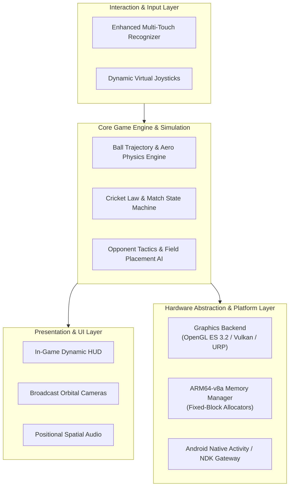

# Cricket Legacy — Systems Engine Architecture & Mobile Port

[](Documentation/TECHNICAL_ARCHITECTURE.md)
[-3DDC84?style=flat&logo=android&logoColor=white)](Documentation/NATIVE_ANDROID_ARCHITECTURE_ASSESSMENT.md)
[](Documentation/PHASE_B5_GRAPHICS_BACKEND_REPORT.md)
[](Documentation/)
[](LICENSE)

A rigorous systems engineering, reverse-compilation, and platform porting project adapting a legacy sports simulation engine to modern 64-bit mobile architectures (Android ARM64-v8a).

---

## 1. Executive Summary & Systems Context

Legacy sports simulation engines built in the early 2000s were architected around fixed-function pipeline graphics, 32-bit x86 memory address spaces, little-endian disk layouts, and monolithic direct-hardware loops. Migrating such systems to modern mobile operating systems requires rigorous low-level reconstruction:
- **Binary & Memory Alignment:** Overcoming 32-bit to 64-bit pointer expansion, struct padding variances, and memory alignment constraints.
- **Modern Rendering Pipeline:** Bridging legacy graphics calls to contemporary programmable pipelines (OpenGL ES 3.2, Vulkan, and modern Universal Render Pipelines).
- **Asynchronous Touch & Input Subsystems:** Replacing polling-based keyboard/gamepad routines with multi-touch gesture discriminators and frame-rate independent physics loops.

**Cricket Legacy** provides a complete systems feasibility, memory compatibility, and native Android porting framework supported by 15 in-depth technical architecture and benchmarking reports.

---

## 2. Key Capabilities & Technical Highlights

- **Domain-Driven Layered Architecture:** Decouples core simulation physics and rule engines from presentation, graphics backends, and touch input layers.
- **Low-Level Memory & Endianness Auditing:** Comprehensive analysis of asset binary parsing, byte-order conversions, and pointer-width translation between legacy x86 and modern ARM64 targets.
- **Graphics Backend Analysis:** Evaluation of shader compatibility, texture compression standards (ASTC vs legacy DXT), and memory footprint constraints across mobile GPUs (Adreno, Mali).
- **Native Android Prototype Specification:** Complete architectural prototype definition for Android (API Level 24 through 34+) utilizing modern NDK toolchains and Gradle build systems.

---

## 3. High-Level Architectural Layers



---

## 4. Comprehensive Engineering Documentation Index

The `Documentation/` directory houses 15 exhaustive technical reports detailing every phase of systems reconstruction:

| Document | Primary Focus & Domain | Key Insight / Deliverable |
| :--- | :--- | :--- |
| **[TECHNICAL_ARCHITECTURE.md](Documentation/TECHNICAL_ARCHITECTURE.md)** | Core Architecture | Layered domain boundaries, event buses, and simulation loops |
| **[NATIVE_ANDROID_ARCHITECTURE_ASSESSMENT.md](Documentation/NATIVE_ANDROID_ARCHITECTURE_ASSESSMENT.md)** | Mobile Systems | Android NDK integration, JNI boundaries, and lifecycle handling |
| **[PHASE_B5_MEMORY_COMPATIBILITY_REPORT.md](Documentation/PHASE_B5_MEMORY_COMPATIBILITY_REPORT.md)** | Systems Memory | 32-bit to 64-bit pointer expansion, struct alignment, and heap pooling |
| **[PHASE_B5_GRAPHICS_BACKEND_REPORT.md](Documentation/PHASE_B5_GRAPHICS_BACKEND_REPORT.md)** | Computer Graphics | OpenGL ES 3.2 vs Vulkan, ASTC texture compression, draw-call batching |
| **[PHASE_B5_ANDROID_RUNTIME_REPORT.md](Documentation/PHASE_B5_ANDROID_RUNTIME_REPORT.md)** | Operating Systems | Process scheduling, thermal throttling mitigation, and battery constraints |
| **[REVERSE_ENGINEERING_AND_MOBILE_PORT_FEASIBILITY.md](Documentation/REVERSE_ENGINEERING_AND_MOBILE_PORT_FEASIBILITY.md)** | Reverse Engineering | Binary decompilation, disassembly analysis, and static recompilation feasibility |
| **[PHASE_B5_BUILD_INSTRUCTIONS.md](Documentation/PHASE_B5_BUILD_INSTRUCTIONS.md)** | Build Engineering | Reproducible NDK and Gradle compilation procedures |
| **[PHYSICS_SPECIFICATION.md](Documentation/PHYSICS_SPECIFICATION.md)** | Simulation Physics | Magnus effect aerodynamics, pitch friction vectors, and collision models |
| **[TESTING_REPORT.md](Documentation/TESTING_REPORT.md)** | Quality Assurance | Unit test suites, physics determinism checks, and framerate benchmarks |

---

## 5. Repository Layout

```
cricket-legacy/
├── Documentation/                      # 15 exhaustive engineering and architecture reports
├── android-native-prototype/           # Android prototype project structure and native assets
├── .gitignore                          # Build and IDE artifact exclusions
└── README.md                           # System architecture index and engineering documentation
```

---

## 6. Build Prerequisites & Toolchain

- **Target OS:** Android 7.0+ (API 24 minimum, API 34+ target)
- **Target CPU:** `arm64-v8a`
- **NDK Version:** Android NDK r25+
- **Build System:** Gradle 8.0+ / CMake 3.22+
- **JDK:** OpenJDK 17

*For complete step-by-step compilation workflows, see [Documentation/PHASE_B5_BUILD_INSTRUCTIONS.md](Documentation/PHASE_B5_BUILD_INSTRUCTIONS.md).*

---

## 7. License & Attribution

Distributed under the **MIT License**. Reverse engineering and porting investigations conducted strictly for research, interoperability, and preservation purposes.

```bibtex
@software{africawala2026cricketlegacy,
  author = {Africawala, Mohammad Anas},
  title = {Cricket Legacy: Low-Level Engine Recompilation and Android ARM64 Port},
  year = {2026},
  publisher = {GitHub},
  url = {https://github.com/Anas18102004/cricket-legacy}
}
```
